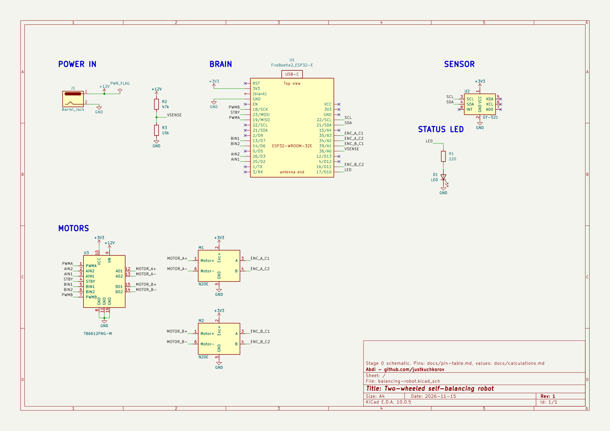
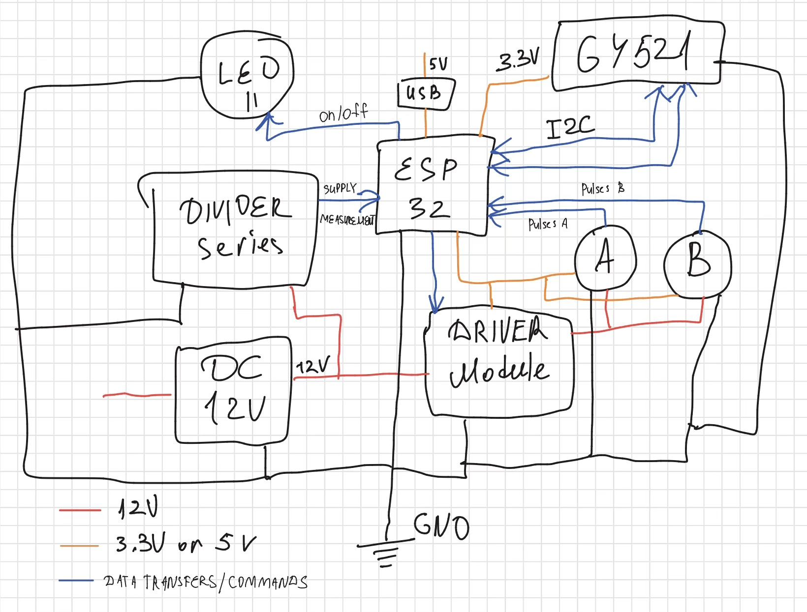

# Two-wheeled self-balancing robot

A small robot that stands on two wheels by itself. An ESP32 reads a tilt sensor and drives the
motors so the robot stays upright. I am building it step by step, from paper to a robot that stands.



## Why I am building it

I am very excited while I work on it. I enjoy the process, and at the end I will see my finished
project as something physical. I also feel that I do my best work when I follow my interests,
instead of sticking with something I don't love. (Paul Graham's essays made me think this way.
Maybe I am wrong.)

## What it will do

It will balance on two wheels while it drives forward and backward. Later I want to add "eye"
sensors, so it can go somewhere on its own when I give it a command.

## Status

| Stage | What | Status |
|---|---|---|
| 0 | Block diagram, pin table, calculations, KiCad schematic | done |
| 0b | Body in Fusion: motor mounts, plate, frame | in progress |
| 1 | A wheel spins (PWM) | waiting for the parts |
| 2 | A wheel is measured (encoder) | |
| 3 | Speed control loop (PI) | |
| 4 | Tilt angle from the IMU | |
| 5 | The robot stands: battery, printed body, video | |

## Parts

Most of them are still on order.

| Part | Job |
|---|---|
| DFRobot FireBeetle 2 ESP32-E | the brain: reads the sensors and decides |
| 2× N20 gear motor with Hall encoder, 12 V, 500 rpm (N20E-12-500) | drive the wheels and measure their speed |
| TB6612FNG motor driver module | switches the 12 V to the motors |
| GY-521 (MPU-6050) | measures tilt and rotation |
| 2× 42 mm wheels | |
| 12 V 2 A adapter and DC socket | power for the motors (a battery comes later) |
| 47k and 10k resistors | a divider, so the ESP32 can watch the 12 V supply |
| red LED and 220 Ω | status light |

## How it fits together



The sensors report, the ESP32 decides, the driver acts. The 12 V goes only to the driver and the
divider. Everything else runs on 3.3 V, and nothing above 3.3 V touches an ESP32 pin.

- Which pin does what, and why: [docs/pin-table.md](docs/pin-table.md)
- The 7 calculations (logic levels, pull-ups, power, LED, divider, encoder, wheel speed):
  [docs/calculations.md](docs/calculations.md)
- The schematic: [docs/schematic.pdf](docs/schematic.pdf)

## Lessons that cost me the most

- **The ESP32 is the "PLC", not the sensor.** At first I wired the GY-521 to the encoders, because
  I thought the GY-521 or the driver module worked like a PLC. Then I understood that the ESP32
  plays that role: all the information from the sensors comes to the ESP32, and the ESP32 decides
  what happens next.
- **The divider needs an analog pin.** First I put the 12 V divider on GPIO16. That is a digital
  pin: it only reads HIGH or LOW. But the divider is for monitoring: to know if the 12 V supply is
  normal or dropping, so if something goes wrong, the ESP32 knows and can shut the motors down. For
  that it needs a pin that measures voltage, so I moved it to GPIO36 (A0).

Other mistakes I made: I used the wheel's 42 mm diameter as its radius; I put 3.3 V across the LED
resistor instead of 1.3 V; I used the adapter's 2 A as the divider current. In the schematic I
first wired both motors straight to 12 V (that would have burnt the driver) and drew the divider
without GND. All of them are fixed, and the numbers are in [docs/calculations.md](docs/calculations.md).
The block diagram took five tries: [docs/](docs/).

## What I learnt

- Fundamental things from my major became real: voltage dividers and pull-up resistors.
- **A taller robot is easier to balance.** I thought a smaller robot would be better. But it is
  like a broom and a pen: you can balance a broom on your hand easily, but not a pen, because the
  pen falls faster. So a taller robot is better.

## What's next

- Stage 0b: design the body in Fusion.
- When the parts arrive: Parts 1 to 5, from one spinning wheel to a robot that stands.
- Later: control from my phone, distance "eyes", driving around the room on its own, and maybe AI
  one day, so it becomes my own little "Jarvis".

## Repository

```
docs/block-diagram-*.jpg    hand-drawn block diagram: tries 1 to 4 and the final one
docs/pin-table.md           which ESP32 pin does what, and why
docs/calculations.md        the 7 calculations, my predictions and my mistakes
docs/schematic.pdf, .png    KiCad schematic (ERC: 0 errors, 0 warnings)
docs/layout-try-*           hand-drawn body layout: tries 1 to 3
hardware/balancing-robot/   KiCad 10 project and my symbol library
hardware/fusion/            Fusion design: motor model, wheels, body block (work in progress)
```
